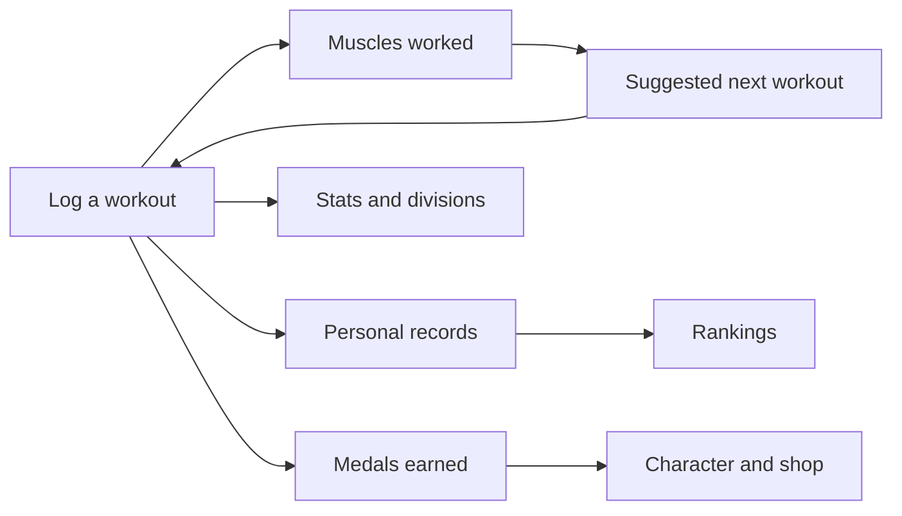
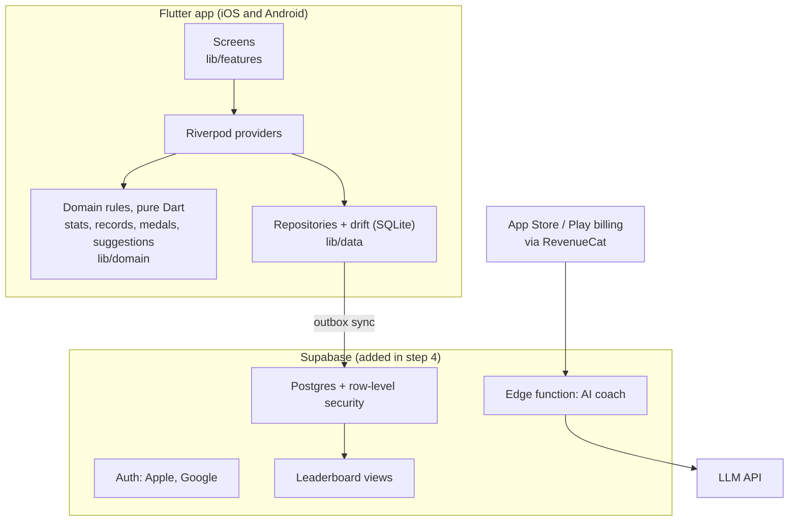
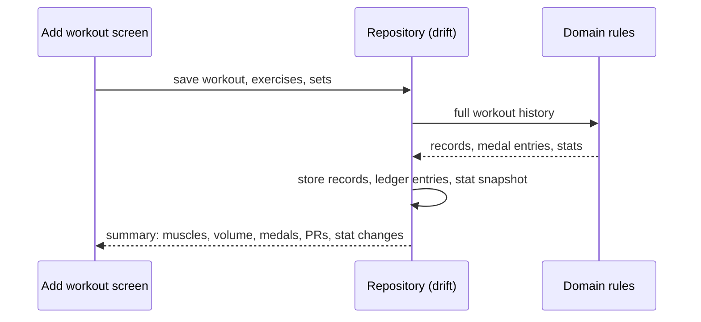

# Horsepower 馬力 마력

A workout tracker where real training becomes game-like stats.

You log workouts. The app turns them into seven fitness stats, awards medals, lets you dress a character with those medals, and ranks your raw records against other people.

## Why it exists

Most workout apps are either a plain logbook or a game with a single "level" that goes up no matter what you do. Horsepower sits between the two:

- **Stats mean something.** Strength comes from your actual bench, squat and deadlift. Cardio comes from your actual pace. Nothing goes up just because you opened the app
- **No single level.** Seven separate stats show where you are strong and where you are not. A heavy lifter who never runs sees it
- **It nudges balance.** The app shows which muscle groups you skipped and suggests what to train next
- **Rewards are cosmetic.** Medals buy character items only. They never buy stats or rank

It is for people who already train and want a reason to keep showing up, in English and Korean from day one.

## How it works

### Stats

| Stat | Built from |
|---|---|
| Strength | Best bench press, squat and deadlift (raw kg, not bodyweight-adjusted) |
| Cardio | Fastest mile, fastest 5K, average pace |
| Endurance | Distance in the last 7 days, longest run, total cardio time |
| Consistency | Workout days in the last 7 days, streak, workouts in the last 30 days |
| Volume | Sets, reps and weight lifted |
| Muscle balance | How evenly the 11 muscle groups were trained in the last 7 days |
| Overall | Weighted average: 30 / 20 / 15 / 15 / 10 / 10 |

Stats have no maximum. Each score maps to a division at fixed thresholds:

| 0–19 | 20–39 | 40–59 | 60–79 | 80–99 | 100–119 | 120–149 | 150+ |
|---|---|---|---|---|---|---|---|
| Rookie | Bronze | Silver | Gold | Platinum | Diamond | Elite | Legend |

### Medals and character

- Medals are the app currency: earned for logging workouts, setting records and weekly goals
- Every medal change is a line in a history, so you can see why you earned or spent each one
- Medals buy cosmetic items (shirt, shoes, belt, background, frame, badge) for your character

### Rankings

- Ranked by raw records: lifts, powerlifting total, pace, distance, streak, weekly volume
- Filters by gender, weight class and age group, in any combination
- A filter changes your rank position. It never changes your stat or division

### AI coach

- Free: a rule-based suggestion from the muscle groups you missed
- Premium (later): an LLM plan built from a weekly summary of your training

## Architecture

Local-first. The app works fully offline on one phone; the server is added later for accounts, sync and leaderboards.

| Layer | Folder | Does | Rule |
|---|---|---|---|
| Screens | `lib/features/<feature>` | One folder per screen group | No business logic; text only from translation files |
| State | Riverpod providers | Connects screens to data and rules | Live queries, so screens update on their own |
| Domain | `lib/domain` | Stat formulas, record detection, medal rules, suggestions | Pure Dart, no Flutter or database imports, fully unit tested |
| Data | `lib/data` | drift tables and repositories | The only layer that touches SQLite or the network |
| Shared | `lib/app`, `lib/l10n`, `lib/shared` | Routing, theme, translations, common widgets | |

### What happens when you save a workout

### Design decisions

| Decision | Why |
|---|---|
| Workouts are the only source of truth | Stats and records are always recalculated from workout history, so editing or deleting a workout can never leave them wrong |
| Medals are an append-only ledger | Balance is the sum of entries. History explains every medal, and a deleted workout is a reversal line, not a rewrite |
| Exercises have stable IDs | Names are translated; logic never matches on an English name |
| Reason codes, not sentences | Medal reasons and coach suggestions are stored as codes and translated on screen |
| Stat scores use the last 7 days | A calendar week would reset scores every Monday |
| A workout stores its calendar date | Travelling across time zones never moves a workout to another day |
| IDs are UUIDs with `updated_at` / `deleted_at` from the first schema | Sync can be added later without a migration |
| Leaderboard records are computed on the server | Client numbers are never trusted for public ranks; implausible records are flagged |
| LLM gets a weekly summary, never raw history | Less data leaves the device, lower cost |

### Tech stack

| Area | Choice |
|---|---|
| App | Flutter (Dart), iOS and Android |
| State and routing | Riverpod, go_router |
| Models | freezed, json_serializable |
| Local database | drift (SQLite) |
| Languages | Flutter gen-l10n, English and Korean |
| Backend (later) | Supabase: Postgres, auth, edge functions |
| Payments (later) | RevenueCat over App Store / Play billing |

## Roadmap

| Step | What | At the end you can… |
|---|---|---|
| 0 | Setup | open an empty app with 5 tabs in both languages |
| 1 | Workout logger | set up a profile and log, edit and delete workouts and runs |
| 2 | Stats and records | see stats, divisions, PRs, medals earned and a suggestion |
| 3 | Game layer and remaining screens | spend medals, see mock rankings |
| 4 | Accounts and sync | sign in and see the same data on two devices |
| 5 | Leaderboards | rank against real users |
| 6 | Premium and release | subscribe for the AI coach; app in both stores |
| Later | Extras | GPS run tracking, body diagram muscle map |

Issue-level detail: the [project board](https://github.com/users/Leevera300/projects/3).

## Rules that never change

- No single user level; multiple uncapped stats with fixed division thresholds
- Rankings use raw records; strength is never bodyweight-adjusted, weight class filters exist for fair comparison
- Filters change rank, never division
- Medals and items are cosmetic only and cannot buy ranking power
- Every visible string comes from the English and Korean translation files

## Status

- `master`: the original Expo / React Native MVP, kept as reference
  - Run it with `npm install`, then `npm start`
- Flutter rewrite starts 2026-11-30 on `dev`; the Expo code is removed once the rewrite passes the spec
