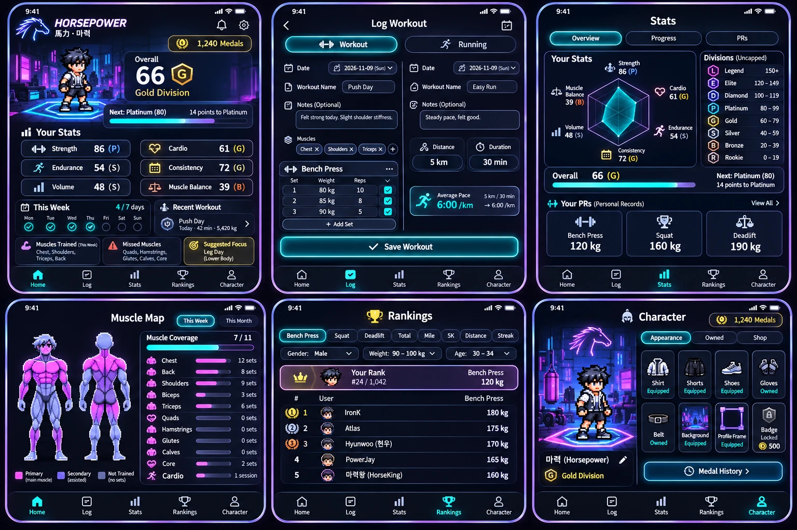
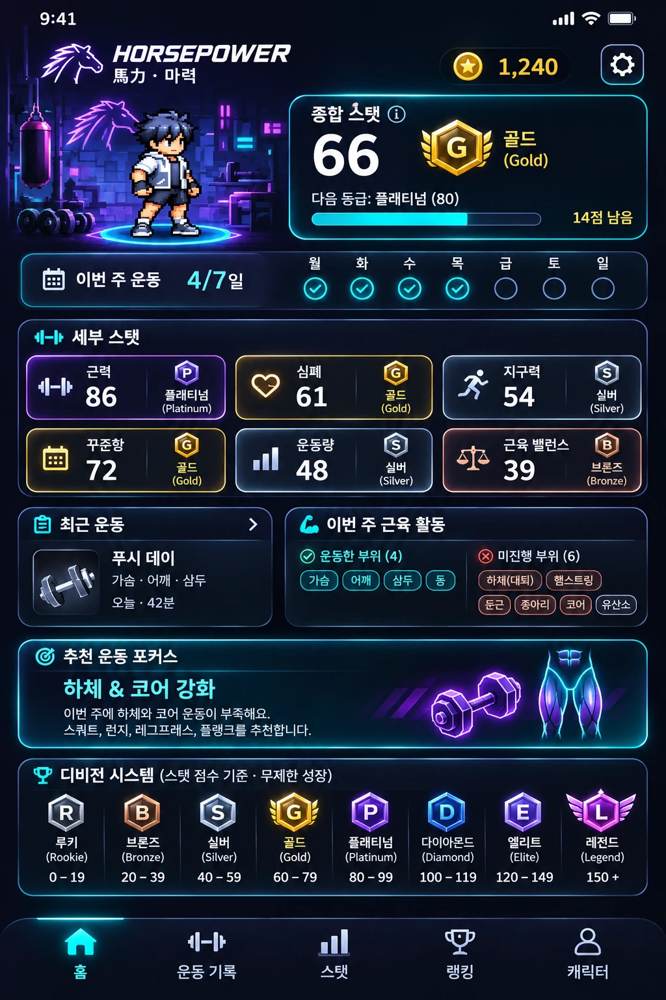

# Horsepower overall plan

Flutter rewrite of the Expo MVP, built from the original spec. Issue numbers are `Leevera300/horsepower-workoutapp`.
Details per issue: [issues.md](issues.md). Project overview: [README](../README.md). Start: 2026-11-30.

## Order

Each step ends with something you can use on your own phone.

| Step | What | Issues | You can… |
|---|---|---|---|
| 0 | Setup | #1 #2 #3 #4 | open an empty app with 5 tabs, in English and Korean |
| 1 | Workout logger | #5 #6 #12 #13 #14 #15 #17 | set up a profile and log, edit and delete real workouts and runs |
| 2 | Stats and records | #7 #8 #9 #10 #11 #16 #18 #19 #20 #21 | see stats, divisions, PRs, medals earned, muscles trained and a suggestion |
| 3 | Game layer and remaining screens | #22 #26 #23 #24 #25 #27 | spend medals, see mock rankings, pass the spec's 11-point list; Expo code removed |
| 4 | Accounts and sync | #39 #28 #29 #30 | sign in and see the same data on two devices |
| 5 | Leaderboards | #32 #33 #34 | rank against real users |
| 6 | Premium and release | #35 #36 #40 | subscribe for the AI coach; app submitted to both stores |
| Later | Extras | #37 #38 | GPS runs, body diagram |

## Why this order

- Workout logging first: every other feature reads workouts. Stats, medals and rankings on mock data get rewritten once real data exists
- You use the app for your own training from the end of step 1, so real data and real annoyances shape steps 2 and 3
- Language is not a step. The plumbing is one small issue (#4) in setup; after that each screen adds its strings to both files in the same PR. Adding Korean later means touching every screen twice
- Stats before the game layer: medals and the shop are only worth anything once the numbers behind them are right
- Nothing server-side until the local app passes the spec (#27). Accounts, sync and leaderboards depend on a schema that has stopped moving

## Differs from the spec's "MVP Priority"

- Spec: dashboard on mock data (4) before workout logging (5). Here: logging first, dashboard on real data
- Spec: React Native + AsyncStorage. Here: Flutter + drift (already decided)
- Spec: stats on "this week". Here: last 7 days for scores, calendar week for medals and lists

## Issue changes made for this order (applied 2026-11-12)

- #12: depends on #5, #6 only; creates all tables
- #16: wires saving a workout to the domain rules and owns the end-to-end checks (S → M); depends on #14, #10, #17
- #17: depends on #14 only
- Dates recomputed for every issue; a step starts only after the previous step ends (2026-11-30 → 2027-08-05)

## Gaps against the spec

- #13 has no name field; the spec's User has `name` (also the display name for #32)
- Leaderboard categories: resolved, Mile and 5K replace average pace and #9 adds most weekly volume
- AI inputs "recovery" and "available workout days" (#35) are not in the profile; fine for now, needed before #35
- PR medal: +50 in the full list, +20 in the MVP rules (#26)

## Design: Neon Pulse mockups (v2, 2026-11-12)

Direction: dark futuristic interface, cyan and purple accents, gold for medals, pixel-art character. Visual reference only, not a functional spec. v1 is kept as [mockups/v1.webp](mockups/v1.webp).

### Screens covered

| Mockup | Issues | Status in v2 |
|---|---|---|
| Home (English) | #18 | Rules fixed; too dense, use the Korean layout |
| Home (Korean) | #18 | Reference layout for Home |
| Log Workout (strength and running) | #14 #15 | Close; no "Add exercise" button |
| Stats | #19 #20 | Good; Progress and PRs tabs not drawn |
| Muscle Map | #21 #38 | Good |
| Rankings | #23 #32 | Rules fixed; categories differ from the spec |
| Character | #22 | Good |

### Fixed since v1

- All 8 divisions with the right ranges, marked uncapped
- No "Lv."; no "+" on the medal balance
- Overall is 66 (Gold) with a matching badge and "14 points to Platinum"
- Rankings use raw records with units, a pinned "Your Rank" row and all three filters
- Home has recent workout, muscles trained, missed muscles and suggested focus
- Log has date, name and notes; timer and templates are gone; running entry shows live pace
- Muscle map has 11 groups, set counts and coverage 7 / 11
- Character has the 8 spec slots with equipped / owned / locked states and a medal history link

### Still to fix

- Home (English): bell icon is still there; nothing in the plan sends notifications
- Home: recent workout shows "42 min" although strength workouts have no duration
- Home vs Muscle Map disagree: the map shows 7 groups trained (Chest, Back, Shoulders, Biceps, Triceps, Core, Cardio), Home lists 4 trained and Core as missed
- Home (Korean): Friday reads "급", should be "금"; "하체(대퇴)" should be "대퇴사두"; division names are doubled as "골드 (Gold)"
- Home (Korean): the division table takes a full section; move it behind the info icon
- Log: no "Add exercise" button; muscle chips have "×" and "+" although muscles are detected from the exercises
- Log: run duration shown as "30 min"; the field is h:mm:ss
- Rankings: tabs are Bench, Squat, Deadlift, Total, Mile, 5K, Distance, Streak. The spec has Average pace, Weekly distance, Longest run and Weekly volume, and has no Mile or 5K (decision below)
- Muscle Map: the bars beside the set counts have no defined scale

### Still no mockup

- Welcome, Language select, Profile setup (#13)
- Workout summary (#16)
- Stat detail (#19), and the Progress and PRs tabs
- AI Coach Preview (#24)
- Settings (#25)
- Medal history (#22)
- Shop tab and the item list inside a slot (#22)

### Decisions the mockups raise

- Decided 2026-11-12: leaderboards use Mile and 5K, not "Average running pace". The 10 categories are the records from #9: bench, squat, deadlift, powerlifting total, fastest mile, fastest 5K, longest run, most weekly distance, longest streak, most weekly volume. The mockup still lacks Longest run and Weekly volume tabs
- Primary / secondary muscles on the body figure need a flag in the exercise catalog (#6)
- "This Month" on the muscle map is new

### Technical notes for building it

- Pixel-art items need one sprite layer per item on a fixed canvas, aligned to the base character
- Radar chart needs a scale rule for uncapped stats
- The English Home fits six cards and three panels on one screen only at very small text sizes; plan for scrolling as in the Korean layout
- No issue yet for the shared theme and widgets (stat card, 8 division badges, neon button, tab bar)

## Rules that never change

- No single level; multiple uncapped stats; fixed division thresholds
- Leaderboards use raw records; filters change rank, never division
- Medals are cosmetic only and cannot buy ranking power
- English and Korean from the first screen
